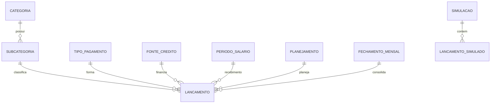

# Domínio

Fonte dos requisitos: [App Finanças – Requisitos Funcionais.md](<App Finanças – Requisitos Funcionais.md>) (IDs `RF-xxx`, `RN-xx`, decisões Q1–Q15). Este documento detalha o modelo e as regras para implementação; se divergir da especificação, a especificação prevalece.

## 1. Glossário

| Termo                    | Definição                                                                                         |
| ------------------------ | ------------------------------------------------------------------------------------------------- |
| Lançamento               | Objeto central; pode ser **planejado** ou **realizado**                                           |
| Categoria / Subcategoria | Agrupadores; a categoria tem natureza Receita ou Despesa; a subcategoria pertence a uma categoria |
| Período de salário       | Divisão do mês por recebimento (ex.: Vale dia 15 cobre 1–15; Pagamento dia 30 cobre 16–31)        |
| Tipo de pagamento        | Dinheiro, Digital, Crédito etc.; `eh_credito` ativa fonte e parcelas                              |
| Fonte de crédito         | Cartão, empréstimo ou outro, com dia de vencimento (e fechamento, só cartão)                      |
| Planejamento             | Orçamento anual com revisões numeradas (Em elaboração, Em revisão, Confirmado)                    |
| Planejamento ativo       | Planejamento confirmado mais recente do ano                                                       |
| Fechamento mensal        | Consolida os realizados do mês e o trava                                                          |
| Simulação                | Cenário hipotético de compra; não altera dados reais                                              |

## 2. Entidades

Usuários são o `User` padrão do Django, gerenciados pelo admin. O sistema é **multiusuário sem isolamento** (decisão Q1): todos veem os mesmos dados; a autoria fica nos campos `criado_por`/`modificado_por`. Não há entidade `Familia` nem FK de dono.

### Categoria (RF-001)

| Campo    | Tipo           | Regras                                               |
| -------- | -------------- | ---------------------------------------------------- |
| nome     | CharField(100) | único por natureza                                   |
| natureza | TextChoices    | RECEITA, DESPESA                                     |
| ativa    | Boolean        | com subcategorias/lançamentos: inativar, não excluir |

### Subcategoria (RF-002)

| Campo     | Tipo           | Regras                                 |
| --------- | -------------- | -------------------------------------- |
| categoria | FK Categoria   | obrigatória                            |
| nome      | CharField(100) | único dentro da categoria              |
| ativa     | Boolean        | com lançamentos: inativar, não excluir |

Exibição sempre como "Categoria – Subcategoria".

### PeriodoSalario (RF-003)

| Campo                          | Tipo           | Regras                                                                                          |
| ------------------------------ | -------------- | ----------------------------------------------------------------------------------------------- |
| nome                           | CharField(100) | ex.: Vale, Pagamento                                                                            |
| dia_recebimento                | Integer        | 1–31 (mês curto: último dia)                                                                    |
| dia_inicio / dia_fim           | Integer        | 1–31; intervalo que o período cobre                                                             |
| descricao                      | CharField(200) | opcional                                                                                        |
| vigencia_inicio / vigencia_fim | DateField      | `vigencia_fim` nulo = vigente; períodos vigentes não se sobrepõem e cobrem todos os dias do mês |

A sobreposição é recusada ao salvar (`services.validar_sem_conflito`). A cobertura dos dias 1–31 não bloqueia o salvamento, pois o conjunto é montado período a período; a tela de períodos avisa os dias descobertos (`services.lacunas_de_cobertura`). Troca de empresa: `services.encerrar_vigencia` fecha os períodos em aberto e um novo conjunto é cadastrado.

### TipoPagamento (RF-004)

| Campo      | Tipo           | Regras                                        |
| ---------- | -------------- | --------------------------------------------- |
| nome       | CharField(100) | único                                         |
| eh_credito | Boolean        | se verdadeiro, exige fonte e parcelas (RN-07) |

### FonteCredito (RF-005)

| Campo          | Tipo           | Regras                                     |
| -------------- | -------------- | ------------------------------------------ |
| nome           | CharField(100) | ex.: Santander                             |
| tipo           | TextChoices    | CARTAO, EMPRESTIMO, OUTRO                  |
| dia_vencimento | Integer        | 1–31; mês curto: último dia                |
| dia_fechamento | Integer (null) | só CARTAO; opcional; mês curto: último dia |
| ativa          | Boolean        | usada em lançamentos: só inativar          |

### Planejamento (RF-011, RF-016, RF-017)

| Campo                  | Tipo               | Regras                                                        |
| ---------------------- | ------------------ | ------------------------------------------------------------- |
| ano                    | Integer            |                                                               |
| revisao                | Integer            | 0 = original; 1, 2, 3... = revisões; único por (ano, revisao) |
| estado                 | TextChoices        | EM_ELABORACAO, EM_REVISAO, CONFIRMADO                         |
| ativo                  | Boolean            | no máximo um ativo por ano (o confirmado mais recente)        |
| revisao_origem         | FK self (null)     | planejamento copiado ao criar a revisão                       |
| criado_em / criado_por | DateTime / FK User | histórico de revisões lista data e usuário                    |
| confirmado_em          | DateTime (null)    |                                                               |

Restrição: no máximo um planejamento não confirmado (`EM_ELABORACAO` ou `EM_REVISAO`) por ano, via `UniqueConstraint(fields=['ano'], condition=~Q(estado='CONFIRMADO'))` (Q14).

### FechamentoMensal (RF-022 a RF-024)

| Campo    | Tipo        | Regras                                      |
| -------- | ----------- | ------------------------------------------- |
| ano, mes | Integer     | mês da fatura (RN-08); único por (ano, mes) |
| estado   | TextChoices | EM_ANDAMENTO, FINALIZADO                    |

### Lancamento (RF-007)

| Campo                          | Tipo                       | Regras                                                                        |
| ------------------------------ | -------------------------- | ----------------------------------------------------------------------------- |
| situacao                       | TextChoices                | PLANEJADO, REALIZADO                                                          |
| planejamento                   | FK Planejamento (null)     | preenchido nos planejados                                                     |
| fechamento                     | FK FechamentoMensal (null) | realizados criados no fechamento                                              |
| origem                         | FK self (null)             | planejado que originou o realizado; garante idempotência de RF-022 (sugestão) |
| categoria / subcategoria       | FK                         | subcategoria deve pertencer à categoria; natureza vem da categoria            |
| data_compra                    | DateField                  | data em que a compra/pagamento ocorre; igual em todas as parcelas             |
| mes_fatura                     | DateField                  | dia 1; mês em que entra nas grades, fechamento e simulação (RN-08)            |
| valor                          | Decimal(12,2)              | > 0                                                                           |
| tipo_pagamento                 | FK TipoPagamento           |                                                                               |
| fonte                          | FK FonteCredito (null)     | obrigatória se tipo de crédito                                                |
| periodo_salario                | FK PeriodoSalario (null)   | obrigatório em receita de salário (RF-026)                                    |
| parcela_numero / parcela_total | Integer (null)             | total ≥ 1 em crédito                                                          |
| grupo_parcelas                 | UUID (null)                | liga as parcelas de uma mesma compra                                          |
| serie_lote                     | UUID (null)                | liga lançamentos criados em lote (RF-014)                                     |
| pago                           | Boolean                    | só realizados; pago = somente leitura                                         |
| descricao                      | CharField(200)             | opcional                                                                      |
| criado_em / modificado_em      | DateTime                   | automáticos (RN-02)                                                           |
| criado_por / modificado_por    | FK User                    | RN-02                                                                         |

### Simulacao e LancamentoSimulado (RF-025)

- `Simulacao(nome, criado_por, criado_em)`.
- `LancamentoSimulado(simulacao, categoria, subcategoria, data_compra, valor, tipo_pagamento, fonte?, parcelas, mes_primeira_fatura?)`: tabela separada, nunca mistura com `Lancamento`.

## 3. Regras de negócio

IDs conforme a especificação.

- **RN-01:** valores em `Decimal` com 2 casas; nunca `float`.
- **RN-02:** todo lançamento registra criação, modificação, usuário criador e usuário modificador.
- **RN-03:** planejado e realizado são entidades distintas conceitualmente, mesmo quando o realizado nasce de um planejado.
- **RN-04:** planejamento confirmado e mês finalizado são imutáveis (sem edição nem exclusão); validado no backend (`services.py`), não só na interface.
- **RN-05:** saldo do período = receitas − despesas.
- **RN-06:** grades agrupam por Receita/Despesa → Categoria → Subcategoria, com meses em colunas.
- **RN-07:** pagamento em crédito exige fonte e parcelas ≥ 1.
- **RN-08:** o mês de um lançamento nas grades, visões, fechamento e simulação é o `mes_fatura`, não o mês de `data_compra`.
- Lançamento realizado com `pago = True` é somente leitura; pode ser reaberto enquanto o mês não estiver finalizado (RF-023, Q6).
- Categoria, subcategoria e fonte com uso só podem ser inativadas, nunca excluídas.

## 4. Algoritmos

### 4.1 Datas

- Dia inexistente no mês (31 em abril/fevereiro, 29 em ano não bissexto) usa o último dia do mês. Aplica-se a vencimento, fechamento, recebimento e inserção em lote.

### 4.2 Parcelamento (RF-008)

- `valor_parcela = valor_total / n`, arredondado para baixo a 2 casas; a diferença de centavos vai para a última parcela. Ex.: R$ 100,00 em 3x = 33,33 + 33,33 + 33,34.
- Cada parcela é um `Lancamento` com `parcela_numero/parcela_total` e o mesmo `grupo_parcelas` e `data_compra`; `mes_fatura` da parcela n = `mes_fatura` da 1ª parcela + (n − 1) meses.
- Mês da fatura da 1ª parcela (`mes_fatura`):
  - cartão com `dia_fechamento`: compra até o fechamento entra na fatura que vence logo após o fechamento; compra posterior, na seguinte. O `mes_fatura` é o mês desse vencimento. Ex.: fecha dia 10, vence dia 20: compra em 05/10 → 20/10 (outubro); compra em 15/10 → 20/11 (novembro).
  - cartão sem fechamento ou empréstimo: sugestão = próximo vencimento; o usuário pode editar.
- Sem crédito: `mes_fatura` = mês de `data_compra`.
- Data de vencimento (derivada, não armazenada): crédito = `dia_vencimento` da fonte no `mes_fatura` (último dia se o dia não existir); demais = `data_compra`.

### 4.3 Inserção em lote (RF-014) e edição de série (RF-015)

- Um lançamento planejado por mês selecionado (`mes_fatura` = mês escolhido), preservando o dia de `data_compra`; meses dentro do ano do planejamento; todos com o mesmo `serie_lote`.
- Edição com alcance: **somente este**, **este e os seguintes**, **todos da série**. Altera apenas os campos modificados no formulário; em "este e os seguintes" e "todos", sobrescreve ajustes individuais (Q10); a data de cada mês mantém o dia.

### 4.4 Planejamento

- Confirmar: estado `CONFIRMADO`, `ativo = True`; a revisão anterior do ano deixa de ser ativa.
- Revisar: nova revisão numerada copiando apenas os lançamentos planejados do ativo; recusada se houver planejamento não confirmado no ano (Q14).
- Criar: recusado se já houver planejamento não confirmado no ano.

### 4.5 Fechamento mensal (RF-022 a RF-024)

- Iniciar: copia os planejados do `mes_fatura` do mês escolhido, vindos do planejamento ativo, como realizados (`origem` preenchida); idempotente e sem sobrescrever realizados existentes.
- Finalizar: avisa se houver não pagos; depois nada com `mes_fatura` daquele mês pode ser criado, editado ou excluído.

### 4.6 Visão temporal de salário (RF-013)

- Despesas entram no período pela data de vencimento (ver 4.2): o dia dentro de `dia_inicio`–`dia_fim` do período vigente na data; receitas de salário entram no período vinculado.

### 4.7 Simulação (RF-025)

- Por mês do ano: realizados (meses passados) + planejados (meses futuros) + parcelas realizadas de compras parceladas em curso + simulados. Mostra saldo com e sem simulação e a diferença.

## 5. Perguntas em aberto

Nenhuma no momento.
