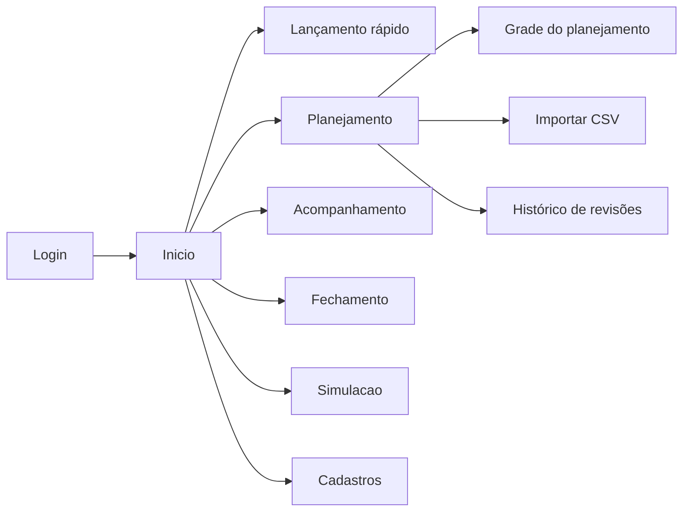

# Telas e fluxos

Requisitos em [App Finanças – Requisitos Funcionais.md](<App Finanças – Requisitos Funcionais.md>).

## 1. Mapa de navegação

## 2. Telas

### T-01 Login e senha (RF-006)

- Login, logout e troca de senha. Sem cadastro e sem recuperação por e-mail (senha redefinida pelo admin).

### T-02 Cadastros (RF-001 a RF-005)

- CRUD simples de Categoria, Subcategoria, Período de salário (com vigência), Tipo de pagamento e Fonte de crédito.
- Itens em uso: apenas inativar. Subcategoria exibida como "Categoria – Subcategoria".
- Fonte de crédito: campo de fechamento visível só para cartão.

### T-03 Lançamento rápido (RF-010) – mobile

- Botão flutuante; campos: valor, subcategoria, tipo de pagamento (+ fonte/parcelas se crédito). Data = hoje; situação = realizado.
- Sugere a última subcategoria e o último tipo de pagamento; até 4 toques além do valor.

### T-04 Formulário de lançamento (RF-007, RF-008, RF-009)

- Adapta-se ao contexto (planejado ou realizado) e à origem (planejamento, acompanhamento, fechamento, rápido).
- Crédito: fonte, parcelas e mês da 1ª fatura (sugerido, editável). Receita de salário: período obrigatório.
- Validações: valor > 0; subcategoria da categoria; fonte/parcelas em crédito.

### T-05 Planejamento – início (RF-011, RF-017, RF-018) – desktop

- Três opções: Criar planejamento, Revisar planejamento, Importar CSV.
- Lista de revisões por ano (número, estado, ativo, data, usuário).

### T-06 Grade do planejamento (RF-012 a RF-016, RF-026) – desktop

- Linhas: Receita/Despesa → Categoria → Subcategoria; colunas: meses.
- Linha **Saldo** fixa sob o cabeçalho, recalculada via HTMX; totais por categoria e grupo.
- Seletor de visão: Ano, Mês, Temporal de salário (mantém ano e filtros ao alternar).
- Inserir em lote: dados do lançamento + meses; ícone de edição discreto; modal de alcance (somente este, este e os seguintes, todos da série).
- Botão **Confirmar planejamento** com confirmação explícita; em "Confirmado" a grade é somente leitura (sem ícone de edição).

### T-07 Importação CSV (RF-018)

- Download do template; upload; relatório de erros por linha antes de gravar; importação atômica ou com confirmação das linhas válidas.

### T-08 Acompanhamento (RF-019 a RF-021)

- Mesma grade e linha de Saldo da T-06 com valores realizados e as três visões.
- Comparativo planejado × realizado × diferença por subcategoria e mês (RF-020).
- Criar/editar realizados; meses finalizados bloqueados.

### T-09 Fechamento mensal (RF-022 a RF-024)

- Escolha do mês e botão **Iniciar** (idempotente); lista dos lançamentos com ícone de edição e opção **Pago** (reabrir permitido até finalizar).
- **Finalizar mês** com aviso se houver não pagos; depois, tudo somente leitura.

### T-10 Simulação (RF-025)

- Cadastro de compras hipotéticas (várias, descartáveis); resultado do ano: realizado (passado) + planejado (futuro) + parcelas em curso + simulado; saldo com e sem simulação e diferença. Conversão em lançamentos reais opcional (M).

## 3. Diretrizes de interface

- Bootstrap 5 com Bootswatch **Flatly** (claro) e **Darkly** (escuro), com alternância na barra superior.
- Planejamento otimizado para desktop; demais telas mobile first. Textos em PT-BR; moeda `R$ 1.234,56`; datas `dd/mm/aaaa`.
- Itens imutáveis (planejamento confirmado, mês finalizado, lançamento pago) sem ícone de edição e com indicação visual (cadeado).
- Mensagens de feedback após salvar/erro; sem tela de cadastro de usuário.

## 4. Wireframes

- _Anexar imagens em `docs/wireframes/` e referenciar aqui._
